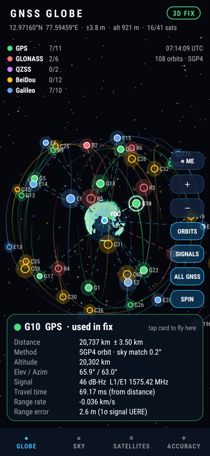
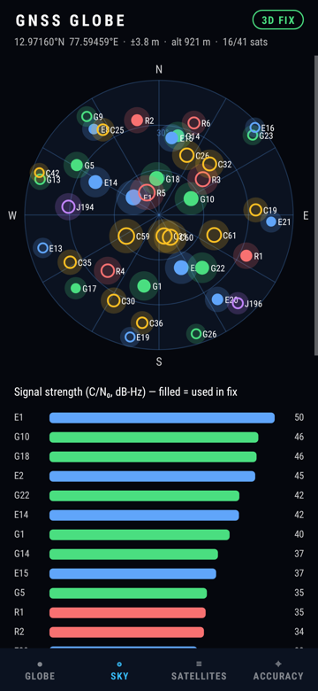
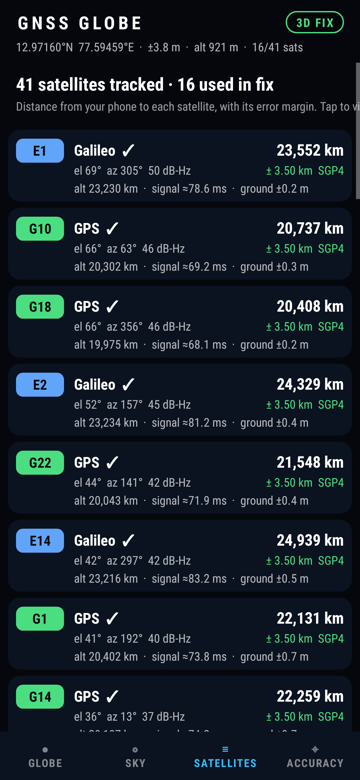
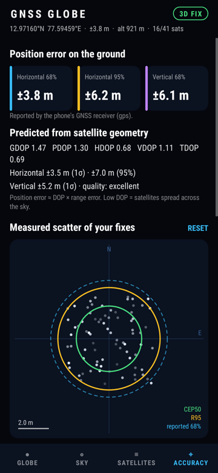
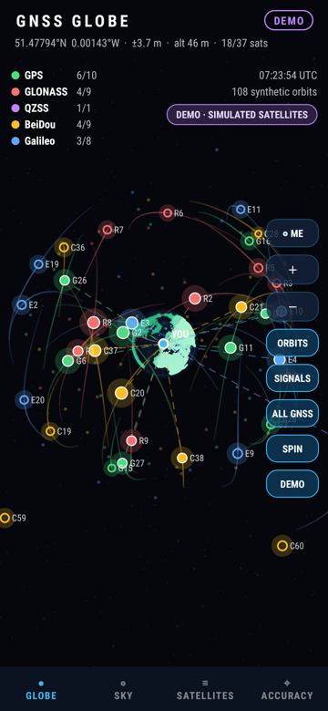

# GNSS Globe — real-time satellite tracker for Android

GNSS Globe finds the navigation satellites your phone is receiving (GPS, GLONASS, Galileo,
BeiDou, QZSS, SBAS, NavIC) and places them in space on an interactive 3-D globe, along with
your own position. For every satellite it gives the **distance from your phone, with an error
margin**. It also measures **how large the position error is on the ground**.

**Install:** download [`release/GnssGlobe.apk`](release/GnssGlobe.apk) to an Android 7.0+
phone, open it and allow installing from this source. Grant location permission, then go
outdoors with a clear view of the sky.

| Globe | Sky | Satellites | Accuracy |
|---|---|---|---|
|  |  |  |  |

*(Screenshots rendered from the real app with simulated satellite input.)*

## Web app

The same globe runs in any browser: **https://shekath.github.io/GPS/** (deployed from `web/`
by GitHub Actions). It downloads live GNSS orbits from CelesTrak, propagates them with the
same SGP4/SDP4 code (ported to JavaScript and tested against the reference implementation),
and places you with the browser's location. Browsers can't read the phone's GNSS chip, so the
web app predicts which satellites a receiver would track and use. The Android app shows the
ones your phone actually uses. Without location access or orbit data, it simulates the sky
from a place you pick and labels it **Simulated**.

To run it locally: `cd web && python3 -m http.server`, then open http://localhost:8000.

## Demo mode (indoor testing)

Tap **DEMO** on the globe, or **TRY DEMO MODE** on the permission screen. Demo mode works
without GPS and without location permission. It shows the sky as a receiver would see it:
satellites above your horizon with realistic signal strengths, a fix from the strongest
16–18, and positions that wander a few metres like real fixes. It uses real orbits when
they are cached, otherwise a built-in synthetic GPS/Galileo/GLONASS/BeiDou/QZSS
constellation. It's placed at your last known position, or at Greenwich if the phone has
never had a fix. Everything is clearly marked **DEMO · SIMULATED SATELLITES**. Tap the
DEMO chip again to return to the real receiver; simulated and real fixes are never mixed.

## Screens

- **Globe** – a dot-matrix Earth with day/night shading and a pulsing marker at your location.
  Each tracked satellite sits at its computed position in space, with a short orbit track and
  animated signal rays to the satellites used in your fix. Faint dots show the rest of the
  GNSS fleet. Drag to rotate, pinch to zoom, double-tap to recenter on yourself. Tap a
  satellite to see its distance, altitude, signal, travel time and error figures.
- **Sky** – a polar az/el plot as the phone sees the sky, plus C/N₀ signal-strength bars.
- **Satellites** – every satellite with its distance ± margin, altitude, signal travel time
  and the ground error it causes.
- **Accuracy** – the error on the ground, from three sources: the receiver's own estimate,
  a prediction from satellite geometry (DOP × range error), and the measured scatter of your
  fixes (CEP50 / R95). Also shows each satellite's contribution and the range-error budget.

## How the distance is measured

1. **SGP4 orbit (default, ±3–10 km).** The app downloads current orbital elements for all
   GNSS satellites from CelesTrak (cached for offline use) and propagates them with a full
   SGP4/SDP4 implementation. The SDP4 deep-space terms (lunar/solar perturbations, 12 h/24 h
   resonance) are included, and the implementation matches the reference code to < 1 m
   (`OrbitTest`). Each tracked satellite is matched to its orbit by PRN and checked against
   the azimuth/elevation the phone reports. The distance is then |satellite − phone|. The
   margin is about 3 km plus 2 km per day of element age.
2. **Orbit-shell fallback (±60–530 km, ±4,000 km for Galileo E14/E18).** When there's no
   orbit data (offline, first launch), the satellite is placed on its constellation's orbit
   sphere along the direction the phone reports. The margin combines orbit eccentricity
   (r = a(1 ± e)) with ±0.5° of elevation uncertainty.
3. **Raw pseudorange** – on phones that support raw GNSS measurements, the signal's travel
   time is measured directly (≈ 67–90 ms). It still includes the satellite clock offset
   and atmospheric delay.

## How the ground error is measured

- **Reported:** the phone's 68 % horizontal/vertical accuracy, scaled to 95 %.
- **Predicted:** least-squares geometry (GDOP/PDOP/HDOP/VDOP/TDOP) from the satellites used
  in the fix, combined with a per-satellite range-error budget. The budget includes clock and
  orbit error, residual ionosphere and troposphere (elevation-mapped), multipath, and receiver
  noise (C/N₀ or measured). Each satellite's range error is projected onto the ground with
  the least-squares gain matrix, giving its own "ground error" in metres.
- **Measured:** the scatter of the last 600 fixes around their mean (CEP50, R95, RMS). This is
  only valid while the phone is stationary.

## Building

Open the project in Android Studio, or run `./gradlew assembleRelease`; GitHub Actions does the
same on every push. There are no third-party dependencies: everything is drawn with the Android
Canvas.
